<picture>
  <source media="(prefers-color-scheme: dark)" srcset="assets/banner-dark.svg">
  <source media="(prefers-color-scheme: light)" srcset="assets/banner-light.svg">
  
</picture>

### Hi, I'm Oğuzhan 👋

I'm a software developer at **[Midas](https://www.getmidas.com)**, where I work on the Midas and Midas Crypto Android apps. Most of my days are Kotlin, Jetpack Compose and modular architecture.

I like to research before I build: understanding how something works, then engineering it carefully. Outside of work I ship my own products with Kotlin Multiplatform, explore what AI makes possible, and write about Android on Medium.

### Selected work

- **[Cosum](https://cosum.app)**: a bill-splitting app for Android and iOS, built with Kotlin Multiplatform and Compose Multiplatform. Get it on [Google Play](https://play.google.com/store/apps/details?id=app.oguzhanozgokce.cosum) or the [App Store](https://apps.apple.com/app/id6798811181).
- **[MidMoney](https://github.com/oguzhanozgokce/MidMoney)**: a native Android market tracker written for its architecture: 22 Gradle modules, convention plugins and a single quality gate.
- **[E-Commerce Compose](https://github.com/oguzhanozgokce/ECommerceCompose)**: an e-market app with product listing, favourites, cart and orders, built with Jetpack Compose. I led the team that built it.
- **[Highwren UI](https://github.com/oguzhanozgokce/web-design-system)**: accessible React components with themes generated from one seed colour.

### Tools I reach for

### Find me

[ozgokceoguz.com](https://ozgokceoguz.com/en/) · [LinkedIn](https://www.linkedin.com/in/oğuzhan-özgökce/) · [Medium](https://ozgokceoguzhan.medium.com/)
